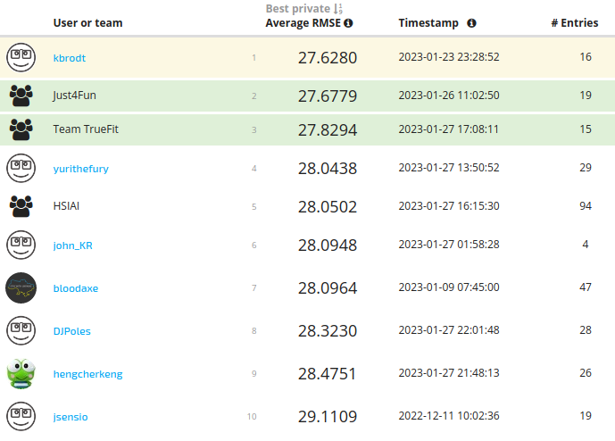

# The BioMassters

[The
BioMassters](https://www.drivendata.org/competitions/99/biomass-estimation/page/534/)

[1st
place](https://www.drivendata.org/competitions/99/biomass-estimation/leaderboard/)
out of 976 participants with 27.6280 Average RMSE score (top2 27.6779).



## Approach

The solution is based on an UNet model with a shared encoder with aggregation
via attention. The inputs to the encoder are 15-band images with a resolution
of 256x256 from joint Sentinel-1 and Sentinel-2 satellite missions. The encoder
is shared for all 12 months. The outputs are aggregated via self-attention.
Finally, a decoder takes as inputs the aggregated features and predicts a
single yearly agbm. We directly optimize `RMSE` using `AdamW` optimizer and
`CosineAnnelingLR` scheduler. We don't compute loss for high agbm values
(>400). We use vertical flips, rotations, and random month dropout as
augmentations. Month dropout simply removes images.

## Highlights

- UNet model
  * Shared `tf_efficientnetv2_l_in21k` encoder for all months. The input is
    15-band images with min-max normalization. Aggregate over all 12 months via
    self-attention at the encoder level
  * Heavy decoder takes aggregated features and predicts single yearly agbm
- `RMSE` loss (ignore high values >400)
- Train 900 epochs on one split (fold), then finetune 200 epochs on full
  dataset, 8 batch size per GPU, mixed precision
  * `AdamW` optimizer with `1e-3` learning rate and `1e-2` weight decay
  * `CosineAnnealingLR` scheduler
- Augmentations: random flips, rotations, and month dropout
- Test time augmentations: left-right and up-down flips

## Prerequisites & Hardware

- GNU/Linux
- [Python 3](https://www.python.org/)
- Nvidia Driver Version: 515.65.01
- CUDA Version: 11.7
- [PyTorch 1.13](https://pytorch.org/)
- 2 x GPU Nvidia A100 40GB VRAM
- 4 x CPU AMD Milan 7413 @ 2.65 GHz 128M cache L3
- 64GB RAM
- 8 days for training
- 5 min for inference

## Setup

Create an environment using Python 3.8. The solution was originally run on
Python 3.8.10. Install the required Python packages

```bash
pip install -r requirements.txt
```

Download the data from the competition page and unzip into `data` folder.

### Windows / RTX 50-series setup

Use the local `.venv` environment with Python 3.11 and CUDA 12.8 PyTorch.
The original PyTorch 1.13 build does not support RTX 50-series GPUs. The
Windows requirements retain the older timm and segmentation-models-pytorch
APIs used by this solution.

```powershell
uv venv --python 3.11 .venv
uv pip install --python .venv/Scripts/python.exe torch==2.7.1 torchvision==0.22.1 --index-url https://download.pytorch.org/whl/cu128
uv pip install --python .venv/Scripts/python.exe -r requirements-windows.txt
.\.venv\Scripts\Activate.ps1
```

Alternatively, invoke `.\.venv\Scripts\python.exe` directly without activation.
Select `.venv\Scripts\python.exe` as your editor's Python interpreter.
Run `python src/train.py --help` or `python src/submit.py --help` to inspect
the available options. The `.sh` launchers require a Unix shell, and multi-GPU
training uses NCCL, which requires Linux/WSL2. For native Windows, invoke the
Python scripts directly for a single GPU and use a smaller batch size than
the original A100 settings.

The tracked `data` and `models` entries are placeholder files containing the
author's Linux paths, not datasets or checkpoints. Download those separately
and pass their actual directories using the scripts' command-line options.
When loading trusted original checkpoints with PyTorch 2.7, set
`$env:TORCH_FORCE_NO_WEIGHTS_ONLY_LOAD = "1"` before running the scripts;
they deserialize complete model objects using `torch.load`.

### Frozen encoder feature extraction

#### Google Colab (`colab-feature-extraction` branch)

Enable a GPU runtime, mount Drive, and fetch the branch. This cell works for
both a fresh clone and an existing clean checkout; it never resets local edits:

```python
from google.colab import drive
drive.mount("/content/drive")
```

```bash
%%bash
set -euo pipefail
if [[ ! -d /content/BiomassEstimation/.git ]]; then
  git clone --branch colab-feature-extraction https://github.com/huzaifa-jawad367/BiomassEstimation.git /content/BiomassEstimation
else
  cd /content/BiomassEstimation
  git fetch origin colab-feature-extraction
  git switch colab-feature-extraction
  git pull --ff-only origin colab-feature-extraction
fi
```

Install extraction dependencies while keeping Colab's CUDA-enabled PyTorch
and torchvision. Do not install the original `requirements.txt` or the
Windows requirements in Colab. If pip requests a runtime restart after
changing already imported libraries, restart before extracting:

```python
%pip install -r /content/BiomassEstimation/requirements-colab.txt
```

Place the trusted checkpoint at `/content/modelo_best.pth`, then run:

```python
!CHECKPOINT="/content/modelo_best.pth" \
TRAIN_FEATURES_DIR="/content/drive/MyDrive/projects/Biomass/Biomassters/train_features/Volumes/Samsung_T5/BIOMASS/BioMasster_Dataset/v1/DrivenData/train_features" \
OUTPUT_DIR="/content/drive/MyDrive/projects/Biomass/Biomassters/extracted_features" \
MAX_SAMPLES=0 BATCH_SIZE=8 \
bash /content/BiomassEstimation/extract_features.sh
```

Those paths, batch size 8, all samples, and `OVERWRITE=false` are the launcher
defaults on this branch. All settings remain configurable. Use `MAX_SAMPLES=100`
for a preview or `NUM_WORKERS=0` for loading inputs in the main process.

The launcher enables `ALLOW_SOURCE_RELOCATION=true` to resume a cache copied
from Windows. Only the recorded input path may differ; checkpoint SHA-256,
normalization, dtype, and shapes must still match. This assumes the source
TIFFs are unchanged. Set this variable to `false` for strict input-path checks.

For `/content/drive/...` outputs, the launcher defaults
`SKIP_DISK_SPACE_CHECK=true`: a mounted Drive's filesystem free-space report
is not a reliable Google account quota check. Check your Drive account's
remaining storage yourself (approximately 382 GiB for a fresh full cache).
Set `SKIP_DISK_SPACE_CHECK=false` to enforce the filesystem preflight. Outputs
elsewhere default to checking disk space. Quota/Drive I/O errors still stop
extraction; already completed samples can be skipped on the next run.

Resume reads only NPY headers and file sizes, with no memory mapping or full
tensor reads. The five resolution folders and per-chip/month filenames are
unchanged. Large numbers of Drive files can still make scanning and extraction
slow when extracting directly from Drive. Use the workflow below to stage
both inputs and outputs on the temporary Colab disk.

#### Recommended Colab notebook: local inputs and outputs

Upload `Colab_Feature_Extraction.ipynb` to Colab and select a GPU runtime. Its configuration
cell contains the supplied Drive paths, checkpoint, six-shard split, batch size,
worker counts, sample limit, and local disk reserve. It fetches this branch and
installs `requirements-colab.txt`. Run the three phase cells for each shard:

1. **Prepare** copies only pending chip/month S1 TIFFs and matching S2 TIFFs
   into `/content/biomass_feature_work/shard_001_of_006/train_features`.
   Missing S2 remains absent and uses the extractor's zero filling. Copies
   are atomic and checked with SHA-256. The preflight includes raw TIFFs,
   five-resolution outputs, and an 8 GiB reserve; it stops before copying
   if they do not fit.
2. **Extract** reads those local TIFFs and writes local NPY files. The GPU
   extraction loop does not read inputs or write outputs through Drive.
3. **Merge** publishes to the single configured Drive `extracted_features`
   directory, verifies copied arrays, and clears verified local TIFF/NPY
   copies. The original Drive TIFFs remain available.

Change `SHARD_ID` from 1 through 6, rerunning the configuration and phase cells.
Alternatively enable `RUN_ALL_REMAINING` in the final cell to process them
sequentially. A failed phase stops the loop. Rerun prepare after an interrupted
copy, extract after interrupted extraction, or merge after interrupted upload.
Already complete samples in Drive are skipped during preparation. Keep
`NUM_SHARDS` stable while resuming; use a new work directory if changing it.
An already selected local shard is never partitioned a second time.

The same phases are available directly through
`python src/colab_feature_workflow.py prepare|extract|merge --help`.
The notebook invokes this repository code for staging and merging. Drive
still supplies the initial TIFF copy and receives the final upload; these
transfers happen outside the GPU extraction phase. The full merged cache
still requires approximately 382 GiB of Drive storage.

#### Alternative: three shards with Drive input reads

Use `NUM_SHARDS=3` and `SHARD_ID=1`, `2`, or `3`. Sharding is deterministic
over sorted chip IDs, keeps all months of a chip together, and happens before
the per-shard `MAX_SAMPLES` limit. Existing outputs never change membership.
The full 8,689-chip input produces:

| Shard | Chips | Chip/month samples | Approximate NPY contents |
| --- | ---: | ---: | ---: |
| 1 | 2,897 | 34,764 | 127.3 GiB |
| 2 | 2,896 | 34,752 | 127.3 GiB |
| 3 | 2,896 | 34,752 | 127.3 GiB |

No shard number is added to the cache manifest or resolution directories, so
all shards merge into the same standard `extracted_features` directory. The
default `NUM_SHARDS=1` retains the original unsharded behavior.

After mounting Drive and installing the Colab requirements, run this cell for
shard 1, then change only `SHARD_ID` to 2 and 3. It stages one shard on the local
Colab disk, merges it into Drive, and removes each local sample only after all
five destination files pass header/size and SHA-256 checks:

```bash
%%bash
set -euo pipefail
export NUM_SHARDS=3
export SHARD_ID=1  # Run again with 2, then 3.
export MAX_SAMPLES=0
export BATCH_SIZE=32
export OUTPUT_DIR="/content/extracted_features_staging"
export RESUME_DIR="/content/drive/MyDrive/projects/Biomass/Biomassters/extracted_features"
export SKIP_DISK_SPACE_CHECK=false

bash /content/BiomassEstimation/extract_features.sh
python /content/BiomassEstimation/src/merge_feature_shard.py \
  --source-dir "$OUTPUT_DIR" \
  --output-dir "$RESUME_DIR" \
  --remove-source
```

The local free-space check is enforced for each shard. `RESUME_DIR` also skips
samples already complete in the merged Drive cache, including after a runtime
reset. A failed merge retains unverified local files; rerun the same cell to
continue. Interrupted cleanup can also resume. `--remove-source` removes only
verified local NPY files, retaining the local manifest and resolution folders.
Omit this option to retain a separate local copy, but clear verified local
data before extracting another shard if the combined size would exceed disk.

The persistent merged directory is on Drive and still needs approximately
382 GiB. Three shards do not make the whole cache fit on a 190 GB local disk;
only one shard resides locally at a time. The shared filename layout remains
compatible with feature-mode training. For all-three automation, replace the
single extraction/merge pair with a loop over `SHARD_ID` values `1 2 3`.

#### Local execution

Run this launcher from Git Bash to extract the first 100 chip/month samples
using the local checkpoint and dataset paths:

```bash
bash ./extract_features.sh --max-samples 100
```

Or run directly in PowerShell with explicit paths:

```powershell
.\.venv\Scripts\python.exe src/extract_features.py `
  --checkpoint "models/tf_efficientnetv2_l_in21k_f0_b8x2_e100_nrmse_devscse_attnlin_augs_decplus7_plus800eb_200ft/modelo_best.pth" `
  --train-features-dir "E:/Datasets/Biomassters/train_features/Volumes/Samsung_T5/BIOMASS/BioMasster_Dataset/v1/DrivenData/train_features" `
  --output-dir "E:/Datasets/Biomassters/extracted_features" `
  --batch-size 4 --num-workers 2 --max-samples 100
```

CLI arguments override launcher defaults. Use `--max-samples 0` for all
samples, `--batch-size 1` to reduce GPU memory use, `--num-workers 0` to load
inputs in the main process, or `--device cpu` for CPU execution. On Linux/WSL,
override the paths with mounted Linux paths and use a Linux virtual environment.
Every extractor option is configurable in the launcher's configuration block
or through environment variables: `CHECKPOINT`, `TRAIN_FEATURES_DIR`,
`OUTPUT_DIR`, `BATCH_SIZE`, `NUM_WORKERS`, `DEVICE`, `MAX_SAMPLES`, and
`OVERWRITE`. `PYTHON` overrides the interpreter; otherwise the launcher uses
the local virtual environment or system `python3` (including Colab).
`OVERWRITE=true` enables recomputation and `OVERWRITE=false` preserves resume
behavior. For example:

```bash
BATCH_SIZE=2 NUM_WORKERS=0 MAX_SAMPLES=100 OVERWRITE=false bash ./extract_features.sh
```

The extractor loads the trusted complete checkpoint, maps its legacy timm
class names, and strictly transfers the encoder weights into the current
encoder. It downloads no pretrained weights. Parameters are frozen and all
computation and saved arrays use float32, with autocast and TF32 disabled.
Outputs precede temporal attention and decoding.

Matching S1 and S2 images supply 15 normalized input bands for each chip/month.
Missing S2 images are filled with zeros, as in training. The sample limit
counts combined chip/month inputs, rather than individual sensor TIFFs.
For example, `0003d2eb_S1_00.tif` and `0003d2eb_S2_00.tif` produce:

| Output relative to extracted_features | Shape (channels, height, width) |
| --- | --- |
| `128x128/0003d2eb_00.npy` | `(32, 128, 128)` |
| `64x64/0003d2eb_00.npy` | `(64, 64, 64)` |
| `32x32/0003d2eb_00.npy` | `(96, 32, 32)` |
| `16x16/0003d2eb_00.npy` | `(224, 16, 16)` |
| `8x8/0003d2eb_00.npy` | `(640, 8, 8)` |

```python
import numpy as np
features = np.load(
    "E:/Datasets/Biomassters/extracted_features/128x128/0003d2eb_00.npy",
    allow_pickle=False,
)
```

The manifest records the checkpoint SHA-256, source directory, normalization,
precision, and output shapes. Rerunning skips samples with five valid arrays;
incomplete samples are recomputed. Use `--overwrite` to recompute the selected
samples. A mismatched manifest is rejected even with `--overwrite`; choose a
separate directory for a different checkpoint or extraction configuration.
Keep the input TIFFs unchanged when resuming into an existing output directory.

The 100-sample test writes 500 arrays totaling about 375 MiB. The full 104,268
samples require about 382 GiB, plus file overhead. Free disk space is checked
before inference; the full run requires more space than the current E: drive
has available. The disk-space check rounds each NPY file, including its header,
to the output filesystem's allocation unit. For example, an exFAT drive with
1 MiB clusters uses 8 MiB per chip/month (about 815 GiB for the full dataset),
despite only 3.75 MiB of tensor data. A filesystem with 4 KiB allocation units
uses about 384 GiB plus metadata. Free space can also change during extraction
if other processes write to the same drive.

### Training

`src/train.py` accepts raw images by default. Add `--feature-mode` to train
directly from the cached encoder features:

```bash
python src/train.py \
  --feature-mode \
  --train-features-dir /content/drive/MyDrive/Biomassters/extracted_features \
  --train-df /content/drive/MyDrive/Biomassters/The_BioMassters_-_features_metadata.csv.csv \
  --train-labels-dir /content/drive/MyDrive/Biomassters/train_agbm \
  --checkpoint-dir ./models/features_run \
  --batch-size 1 --num-workers 2 --num-epochs 100 --augs
```

Point the labels argument to the folder directly containing `chip_agbm.tif`.
Each metadata chip needs all 12 months at all five cached scales. The
100-sample extraction preview contains only eight fully extracted chips;
finish extraction for normal training, or supply metadata limited to those
complete chips and reduce `--n-folds` for a small smoke test.

Feature mode constructs no EfficientNet encoder and downloads no encoder
weights. It trains temporal attention, the decoder, and the prediction head
using the existing optimizer, losses, and fold split. `--augs` uses month
dropout only; spatial augmentation and image-flip validation TTA are disabled.
Feature mode honors `--num-workers`, including zero. Backbone identity and
encoder channel counts come from `manifest.json`.

By default the attention and decoder are freshly initialized. To initialize
them from the original winning checkpoint, append:

```bash
--load ./models/tf_efficientnetv2_l_in21k_f0_b8x2_e100_nrmse_devscse_attnlin_augs_decplus7_plus800eb_200ft/modelo_best.pth \
--dec-channels 384 368 352 336 320 --dec-attn-type scse
```

Complete model checkpoints and training state checkpoints are accepted by
`--load`. Feature mode ignores image encoder weights and strictly loads all
attention/decoder/head weights, so decoder settings must match the checkpoint.
Use `--load .../model_last.pth --resume` to resume a feature run including
optimizer and scheduler state. Resuming requires the same feature manifest
(source paths may change) and training mode. Feature-mode checkpoints contain
no image encoder and are intended for cached-feature inputs.

To run training from the command line

```bash
sh ./run.sh
```

It will take about 8 days on 2 A100 40GB GPUs.

### Inference

Download [pretrained](https://disk.yandex.ru/d/01YXhPyiKZifYw) models and
extract into `models` folder.

```bash
unzip models.zip -d models
```

To run inference from the command line

```bash
sh ./submit.sh
```

It takes ~5 minutes on 1 GPU A100 40GB (note on V100 32GB the results are
slightly different).
